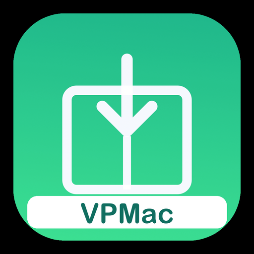

# VPMac — Project Viewpoint en Macs con Apple Silicon

VPMac hace que [Project Viewpoint](https://steamcommunity.com/sharedfiles/filedetails/?id=3809306528) (primera
persona 3D para Project Zomboid B42) funcione en Macs con Apple Silicon. macOS solo tiene OpenGL 4.1 y Viewpoint
necesita 4.2–4.5; VPMac reescribe Viewpoint **en memoria** mientras juegas, sin tocar los archivos del Workshop.

- **Steam Workshop:** [VPMac](https://steamcommunity.com/sharedfiles/filedetails/?id=3827015893)
- **Reportar bugs:** [Discusiones > Bug reports](https://steamcommunity.com/workshop/filedetails/discussion/3827015893/574930637987900322/)
- **English:** [README.md](README.md)

> **Hecho 100% con IA.** VPMac —el código, las herramientas y esta documentación— fue construido con Claude
> (Anthropic), dirigido y probado por [elp4nsho](https://github.com/elp4nsho) (Wenopal). El soporte sigue igual. Este
> repositorio existe para que cualquiera pueda ver exactamente qué hace el mod.

## Para jugadores

Requisitos (suscríbete a los tres):
[ZombieBuddy](https://steamcommunity.com/sharedfiles/filedetails/?id=3619862853) (instalado según su guía),
[Project Viewpoint](https://steamcommunity.com/sharedfiles/filedetails/?id=3809306528) y
[Project Viewpoint - Patch for Mac](https://steamcommunity.com/sharedfiles/filedetails/?id=3812168749) de xiveboy.
**No ejecutes el instalador de "Patch for Mac"**: VPMac solo lee sus archivos.

1. Suscríbete a VPMac y actívalo (sus requisitos se activan con él).
2. Abre el juego y aprueba VPMac en la ventana de ZombieBuddy.
3. Reinicia el juego una vez.

Si el juego se cae o se congela, al volver a abrirlo aparece una ventana con un informe listo: cópialo y pégalo en el
[hilo de bugs](https://steamcommunity.com/workshop/filedetails/discussion/3827015893/574930637987900322/).

## Documentación

| | |
|---|---|
| [Cómo funciona](docs/how-it-works.md) | las piezas y cómo encajan (inglés) |
| [Historia del desarrollo](docs/development-story.md) | cada problema, cómo se encontró y cómo se arregló (inglés) |
| [Laboratorio de shaders](docs/lab.md) | probar shaders del juego contra el Metal del Mac, con capturas (inglés) |
| [Rendimiento](docs/performance.md) | mediciones y herramientas: +75% de FPS (inglés) |
| [Mantener el mod](docs/maintaining.md) | informes de jugadores, versiones, firma (inglés) |
| [Notas de desarrollo](docs/dev-notes-es.md) · [notas del laboratorio](docs/lab-notes-es.md) | notas internas detalladas (español) |

## Lo que no está en este repositorio

- **Código o shaders de Viewpoint**: su licencia prohíbe redistribuirlo. VPMac solo lo modifica en memoria.
- **El puente y las imitaciones de xiveboy**: se usan desde la copia del jugador de su ítem del Workshop (el puente
  deriva en parte de PZ_Optimization de xD3I, sin licencia de redistribución).

## Créditos

Project Viewpoint: ellu y norkus (VPMac no es oficial ni tiene su respaldo; si lo piden, se cambia o se retira).
Puente e imitaciones: xiveboy, que permitió modificar y publicar su parche; VPMac es una **alternativa, no una
competencia**. ZombieBuddy: Zed (MIT). Licencia del código propio de VPMac: MIT.
