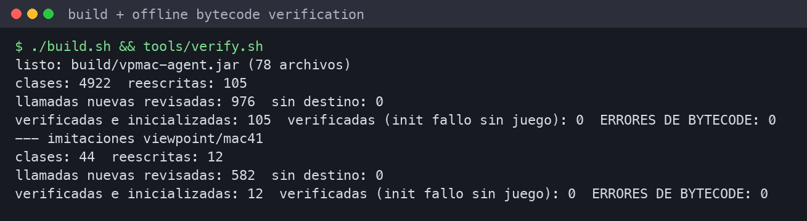
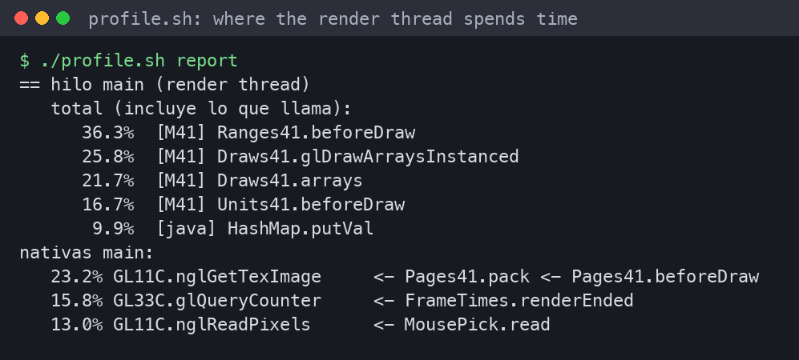
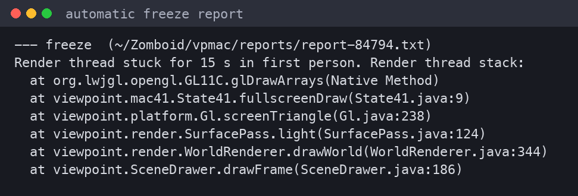
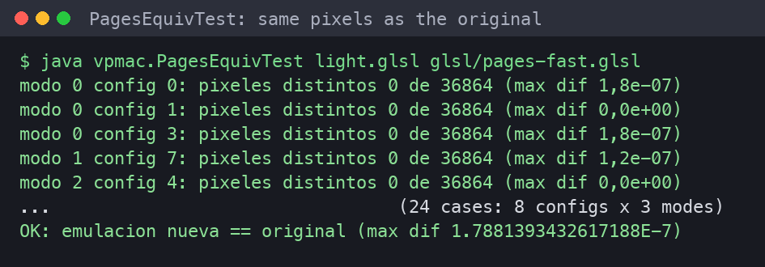

# Development story

How VPMac was built, problem by problem, with the evidence used at each step. Everything was done with Claude
(Anthropic) driving the tools and elp4nsho testing in the game, on a MacBook Air M5 (16 GB, macOS 26.5.1).

## 1. "It worked, then Viewpoint updated" — crash when loading a world

- **Symptom:** the game dies during world loading, right after `[Viewpoint] mesh arena: …`.
- **Evidence:** the macOS crash report (`JavaAppLauncher-*.ips`) shows `EXC_BAD_ACCESS → jni_FatalError → liblwjgl`;
  the call was `MeshArena.recordAttributes → GL43.glVertexAttribFormat`, an OpenGL 4.3 function.
- **Cause:**
  - Steam replaced xiveboy's modified `Viewpoint.jar` (0.1.6) with the official 0.1.6.1.
  - 0.1.6.1 also added calls his patch never covered: texture views for the sun shadow cascades, and program
    interface queries.
- **Fix:** VPMac, a Java agent that applies the same redirections to the official jar as it loads, plus `Views41`
  (texture views) and `Probe` (queries).
  - An offline harness (`tools/verify.sh`) rewrites all 4922 classes of the jar and loads every changed one with the
    game's Java 25 verifier.
  - 96 of 102 rewritten classes came out byte-identical to xiveboy's hand-patched ones; the rest differ only where
    0.1.6.1 changed.

## 2. Pressing O froze the game

- **Symptom:** the world loads, but pressing **O** (first person) freezes the game, with `MTLCompilerService` at
  100% CPU forever.
- **First lead:**
  - A watchdog showed the render thread stuck on the first draw of the **gbuffer** shader.
  - VPMac started dumping the final GLSL, and the [shader lab](lab.md) reproduced the hang outside the game.
  - `lab.py stubs` (empty one function at a time) pointed at the Lanczos sampling chain.

- **Real cause:** the hang was Apple's Metal shader compiler **crashing in a loop**.
  - `MTLCompilerService-*.ips` shows `EXC_ARM_MTE_TAGCHECK_FAIL` in `llvm::DominatorTreeBase::eraseNode`: a
    use-after-free inside Apple's GPU compiler that the M5's memory tagging (MTE) turns into a crash.
  - When the driver gives up, it falls back and crashes itself (`gleFallbackBegin`).
  - The bug is **intermittent**, so a single successful compile proves nothing. `lab.py stress` (N parallel
    compiles, counting new crash reports) became the metric:
    - both Lanczos filters in one shader: 6 crashes in 12 compiles;
    - either one alone: 0 in 12.
- **Fix:** two GLSL rules.
  - `lanczos`: precomputed weights, same result.
  - `lanczos-floor`: no Lanczos on floors in shaders that also use it for sprites; floors fall back to bilinear only
    if the player picked Lanczos.
  - Result: 16/16 compiles, 0 crashes.

## 3. Making it fast

Once it worked, the profiler (`profile.sh` = Java Flight Recorder + `tools/hot.py`) showed where the render thread
spent its time. The details are in [performance.md](performance.md). In short, from 30 to ~53 FPS:
- per-draw bookkeeping in the shims;
- synchronous GPU readbacks;
- textures re-packed every frame;
- a `HashMap`-heavy texture-unit layer.

## 4. Helping players report problems

The goal: if it crashes, the player should get something useful to paste, without knowing anything technical.

- **Session marker:** written at start and marked "clean" on normal exit. If the previous session didn't end clean,
  VPMac builds a report from its `console.txt` (copied before the game deletes it), the macOS crash reports of that
  time, versions, the Mac model and VPMac's settings.
- **Report window:** a macOS window offers *Copy short* (fits a Steam comment) and *Copy full* versions. Reports are
  in English and anonymized.
- **Freeze watchdog:** saves the render thread's stack at the moment of a freeze.
- **Known issues:** a list of understood causes labels new reports automatically ("Known issue: …").

## 5. No installer: a signed ZombieBuddy preload mod

xiveboy needed an external installer (a DMG outside the Workshop) to add `-javaagent` lines to the game's
`Info.plist`. VPMac instead uses ZombieBuddy's *preload*: signed mods load inside ZombieBuddy's own `premain`, before
the game. Players only subscribe, approve once and restart. Licensing shaped the design: the bridge has code without
a redistribution license, so VPMac loads it from the player's own copy of xiveboy's item instead of shipping it
([how it works](how-it-works.md)).

## 6. Modern / High settings froze the game

- **Symptom:** switching Viewpoint to *Modern* and entering first person froze again.
- **Evidence:** the automatic freeze report gave the exact stack on the first try: `SurfacePass.light`.

- **Culprit:**
  - Turning effects off one by one, or in groups, didn't help.
  - A control run did: with xiveboy's **packed-texture emulation** reduced to the minimum, the 7286-line shader
    compiled in 4 ms.
  - In Modern, the light shader reads 19 packed textures, and every `texture()` call inlined ~20 copies of the
    emulated sampling (every filtering path × 4 taps).
- **Fix:** rule `pages-loops`, the same emulation written with loops (one fetch in the code per call).
  - Compiles in 12 ms.
  - `tools/PagesEquivTest.java` renders both versions over 8 texture configurations and 3 modes: **0 different
    pixels**.

## Lessons

- **On a Mac, a shader that "hangs" may be Apple's compiler crashing.** Check
  `~/Library/Logs/DiagnosticReports/MTLCompilerService-*.ips`.
- **Intermittent bugs need a rate, not a single run** (`lab.py stress`).
- **Cutting `main()` to find a culprit is misleading:** the compiler removes everything that becomes unused. Emptying
  functions (`stubs`) works better.
- **Reproduce the game's exact state:** render target formats, textures, vertex attributes (`StateSnap` +
  `--state`).
- **Measure carefully:** the fanless Air throttles after an hour of benchmarks, Low Power Mode cuts FPS, battery
  matters, the game caps FPS at 60, and the screen recorder itself costs ~40%. Interleave A/B runs.
