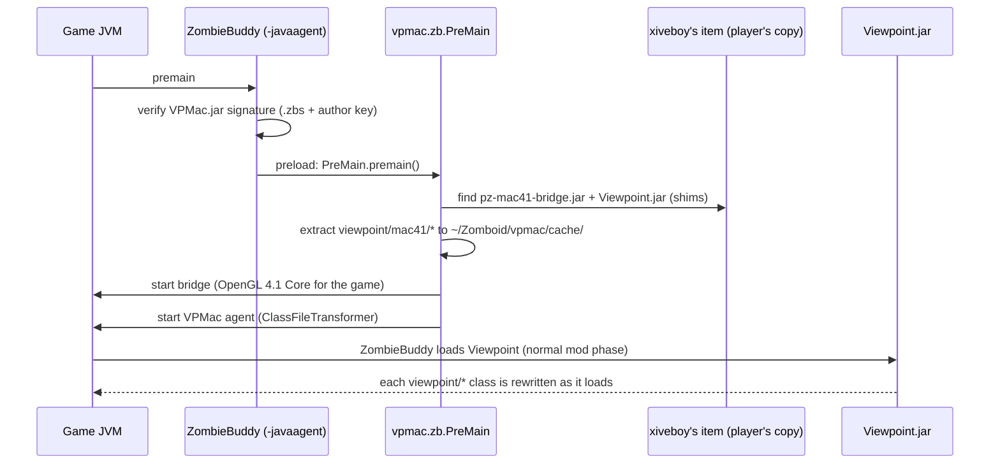
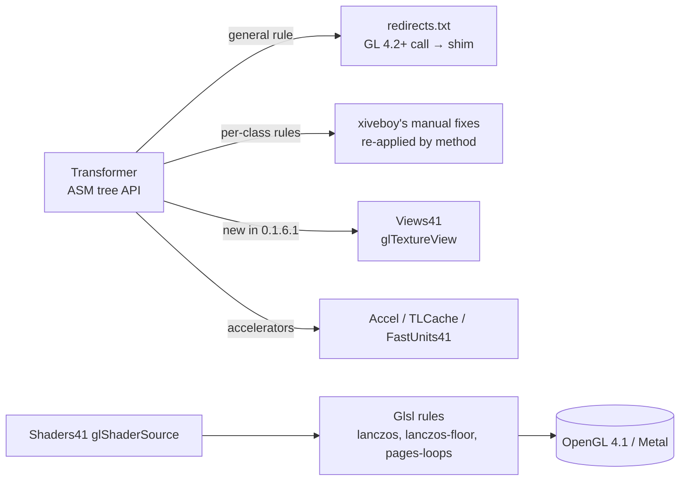

# How VPMac works

## The problem

macOS stopped OpenGL at version **4.1** (running on top of Metal). Project Viewpoint uses OpenGL 4.2–4.5: direct
state access, texture storage, texture views, vertex attribute binding, multi-draw indirect, GPU timestamps, more than
16 texture units per shader… Calling a function the Mac doesn't have is a null pointer, and the game crashes in the
native LWJGL library while loading a world.

xiveboy's "Patch for Mac" solved most of it with two pieces:

1. **A bridge** (`pz-mac41-bridge.jar`): opens an OpenGL 4.1 *Core* context for the game itself and patches a few
   game classes so Project Zomboid runs on it.
2. **Shims** (`viewpoint/mac41/*`, 44 classes): OpenGL 4.1 emulations of what Viewpoint needs, plus a modified
   `Viewpoint.jar` 0.1.6 whose 458 calls were redirected to them.

When Viewpoint updated to 0.1.6.1, Steam replaced the modified jar and the patch stopped working. VPMac does the
redirection **at load time, by rules**, so a Viewpoint update doesn't erase it.

## Startup (Workshop version)

- ZombieBuddy has no public API for this, so `PreMain` reads its `Instrumentation` by reflection
  (`Loader.g_instrumentation`).
- *Preload* mods load in ZombieBuddy's own `premain`, before the game: early enough for the bridge. ZombieBuddy only
  allows it for **signed** jars (Ed25519 over `ZBS:<SteamID64>:<sha256>`, public key on the author's Steam profile).
- The first time, the mod loads in the normal phase (too late), so `vpmac.zb.Main` shows a "restart the game" window.
- Developers can still run VPMac as `-javaagent` lines in `Info.plist` (`install.sh`). `PreMain` detects that and
  doesn't start anything twice.

## The agent

| Piece | File | What it does |
|---|---|---|
| Rewriting | `Transformer.java`, `redirects.txt` | Every `viewpoint/*` class: OpenGL 4.2+ calls → shims. Plus xiveboy's hand-made fixes, found by class and method; if a method is missing (Viewpoint changed), it logs `Viewpoint changed: missing …` instead of failing silently |
| Texture views | `Views41.java` | `glTextureView` (GL 4.3) as a real 2D texture, copied to its array layer (depth blit) right before the array is used |
| GLSL rules | `Glsl.java`, `glsl/` | Applied to every shader right before the driver sees it. Each rule has a name, logs once, and warns if its pattern disappears |
| Accelerators | `Accel.java`, `TLCache.java`, `FastUnits41.java` | Same results, less work per draw ([performance](performance.md)) |
| Reports | `Session.java`, `Report.java`, `Compat.java` | Crash/freeze detection and shareable reports ([maintaining](maintaining.md)) |
| Settings | `Config.java` | `~/Zomboid/vpmac.properties`: `debug`, `fps`, `diag`, `dump`, `bench`, and switches for each accelerator |

Everything the agent writes goes to `~/Zomboid/console.txt` (prefix `[VPMac]`) and `~/Zomboid/vpmac/vpmac.log`.
