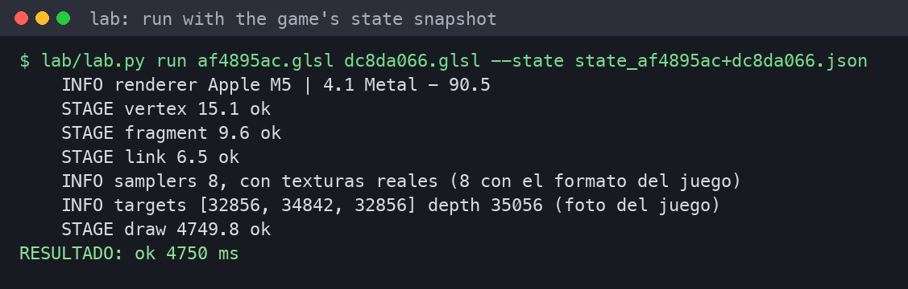
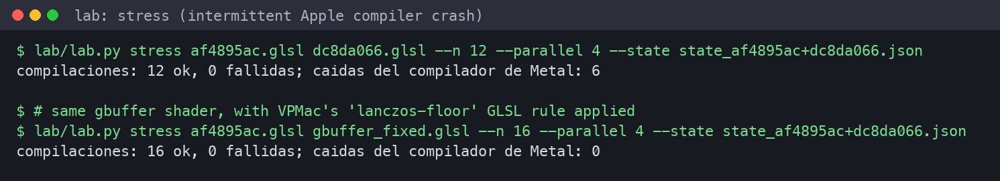
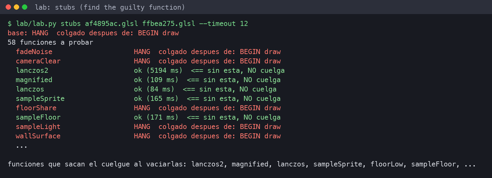
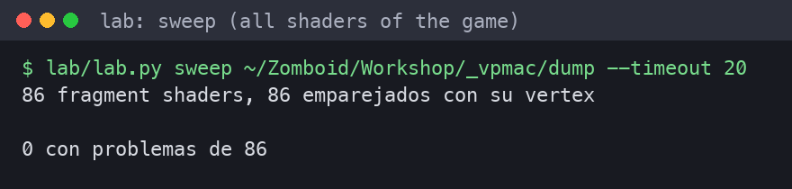
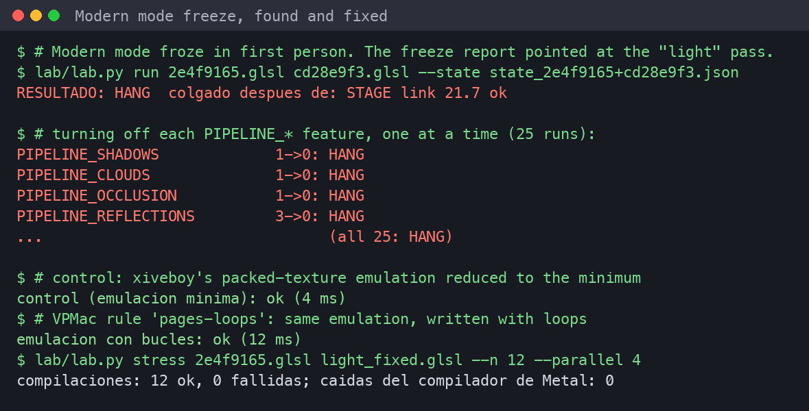

# The shader lab

`lab/` compiles and draws a vertex/fragment shader pair in a **hidden OpenGL 4.1 Core context**, using the same LWJGL
and GLFW as the game, outside Project Zomboid. The first draw is where Apple's driver builds the Metal pipeline and
really compiles, so that is where Metal hangs or crashes. Each test runs in its own process with a time limit,
because a Metal hang can't be interrupted from inside.

Results: **ok** (with the draw time) · **FAIL** (compile/link/GL error) · **HANG** (didn't finish in time) ·
**CRASH** (a new `MTLCompilerService-*.ips` crash report appeared).

> The lab works on shaders *dumped from your own game*. Viewpoint's shaders are not included in this repository
> (its license forbids redistribution).

## Setup

```sh
lab/build.sh                         # compile ShaderLab (uses the game's LWJGL)
```

Get the game's final shaders (after xiveboy's and VPMac's rewrites):

```sh
printf 'diag=true\ndump=true\n' > ~/Zomboid/vpmac.properties   # then play until the problem
# → ~/Zomboid/Workshop/_vpmac/dump/<hash>.glsl   (one file per shader source)
# → dump/state_<vs>+<fs>.json                     (GL state at the first draw of each program)
```

With `diag=true`, `console.txt` says which program each draw uses:
`[VPMac] first draw with gbuffer [af4895ac+dc8da066]`. Those two hashes are the vertex and fragment files.

## Commands

| Command | What it answers |
|---|---|
| `lab.py run <vs> <fs> [--state s.json]` | Does this pair compile and draw? How long? |
| `lab.py stress <vs> <fs> --n 12 --parallel 4` | How often does Apple's compiler crash on it? (intermittent bugs) |
| `lab.py stubs <vs> <fs>` | Which function, if emptied, removes the problem? |
| `lab.py defines <vs> <fs>` | Does turning one `PIPELINE_*` feature on/off change it? |
| `lab.py bisect <vs> <fs>` | Which statement of `main()`? (misleading: see below) |
| `lab.py sweep <dumpdir>` | Pairs every dumped shader and tests them all |
| `lab.py compat <dumpdir>` | Stress-tests every pair: the compatibility check for another Mac |

### run, with the game's exact state

`StateSnap` records the state at the first draw: render target formats, depth/stencil, blending, vertex attributes
with divisors, and each sampler's texture format. `--state` replays it, because Apple's driver compiles a different
variant for each state.



### stress: intermittent compiler crashes



### stubs: find the guilty function

Empties one function at a time (returns a zero value) and reports which ones make the hang go away. Functions that
only *feed* the guilty code also show up, because emptying them makes the compiler drop it.



### sweep: test the whole game



## Worked example: the Modern-mode freeze



1. The freeze report pointed at `SurfacePass.light`; `diag` named the program `light [2e4f9165+cd28e9f3]`.
2. `run --state` reproduced the hang.
3. `defines` and feature groups: no single effect causes it.
4. A control version with the packed-texture emulation reduced to the minimum compiled in 4 ms. So that emulation was
   the cause.
5. Same emulation written with loops: 12 ms. `stress`: 0 crashes. `tools/PagesEquivTest.java` checked the pixels.

## Tips

- **Use `stress`, not `run`, to declare something fixed:** the Apple compiler bug is intermittent.
- **`bisect` lies:** cutting `main()` lets the compiler delete unused code. Prefer `stubs`.
- **Test one change at a time** by text-replacing in a copy of the dump, then port it to `Glsl.java` as a named rule.
- **Check the Java rule produces the exact text you tested** (see `RewriteCheck` in the dev notes) before releasing.
