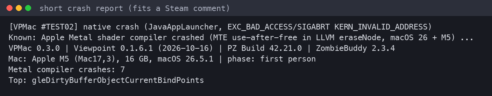

# Maintaining VPMac

## Player reports

When a session ends badly (crash, force quit, freeze), the next start shows a window with **Copy short report**
(≤1000 characters, fits a Steam comment) and **Copy full report**. Players paste it in the
[bug thread](https://steamcommunity.com/workshop/filedetails/discussion/3827015893/574930637987900322/). For bugs
without a crash: `VPMac - Share report.command`.



How to read one:

| Line | Meaning |
|---|---|
| `What:` | native crash / freeze / Java exception / closed unexpectedly |
| `Known issue:` | matched a cause we already understand (`Report.hint`): **add every new cause there** |
| `phase:` | menu, world (isometric), first person, frozen |
| versions, `Mac:`, `VPMac config:` | VPMac, Viewpoint, game, ZombieBuddy, chip/RAM/macOS, switches |
| `--- crash`, `--- freeze` | stack of the crash or of the frozen render thread |
| `--- last Viewpoint stats` | FPS, memory, draws per frame at the end |

To ask a player for more: `debug=true` in `~/Zomboid/vpmac.properties`. For shader problems: `dump=true`, then test
their dump with `lab/lab.py compat`.

## When Viewpoint updates

1. Look at `console.txt` with `debug=true`:
   - `Viewpoint changed: missing …` → a method a rule expected is gone: update `Transformer.java`.
   - `WARNING: … rule 'X' not applied` → a shader changed: update `Glsl.java`.
   - crash with `jni_FatalError` in liblwjgl → a new OpenGL 4.2+ call without emulation: find calls to
     `org/lwjgl/opengl/GL4[2-6]` in the new jar that are not in `redirects.txt`.
2. Freezes/crashes while drawing: check `MTLCompilerService-*.ips`, then `lab.py sweep` and `stress` with `--state`.
3. After every change: `./build.sh && tools/verify.sh` must say `sin destino: 0` and `ERRORES DE BYTECODE: 0`.

## Releasing a new version

```sh
# bump VERSION in src/vpmac/Agent.java
./build.sh && tools/verify.sh            # build + offline bytecode check
./package-zb.sh                          # builds VPMac.jar, signs it (.zbs), writes ~/Zomboid/Workshop/VPMac/
./desc.sh                                # Workshop description (+ Workshop ID, bug thread link, GitHub link)
# upload from the game: main menu → Workshop → VPMac
```

- **Signing:** an Ed25519 key in `~/.signing/vpmac-ed25519.der`. It is **private**: never commit or share it, back it
  up. The public key is on the uploader's Steam profile as `JavaModZBS:<hex>`. ZombieBuddy checks it on every start,
  so the profile must stay public.
- ZombieBuddy also checks that the Workshop uploader is the signer.

## Testing like a new player

- `./zb-test-mode.sh on` leaves only ZombieBuddy in `Info.plist`, so VPMac starts through the preload; `off` restores
  it.
- `tools/PayloadTest.java` checks offline that the Workshop jar finds xiveboy's item and loads the bridge and shims
  from it.

## Other Macs

`./compat-test.sh` runs everything by itself (about 30–40 min) and writes `compat/<chip>_<date>.txt`:
1. a system report;
2. a first-person benchmark;
3. a dump of every shader;
4. a stress test of all of them against that Mac's Metal compiler.
