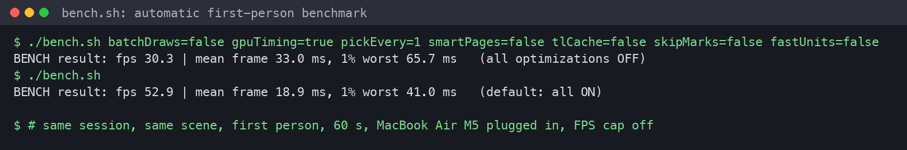
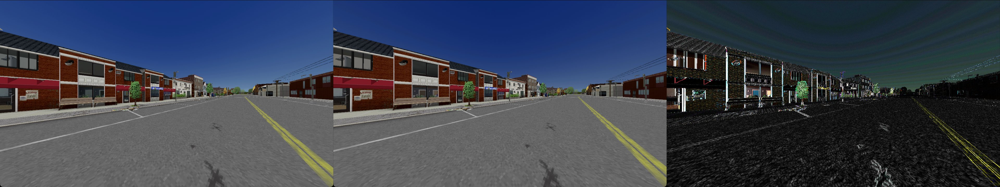

# Performance

All numbers: MacBook Air M5, first person standing still for 60 s, automatic benchmark (`bench.sh`), test scene, Vanilla
graphics mode unless noted.

| Configuration | FPS | 1% worst |
|---|---|---|
| First working version (diagnostics always on, no accelerators) | 32.2 | 45.9 ms |
| Diagnostics opt-in (`Config`) | 33.6 | 44.9 ms |
| + batched draws, no GPU timestamps, mouse pick every 3 frames | 41.4–42.0 | 34.6–36.7 ms |
| + `smartPages` (only pack textures when they don't fit in 16 units) | 50.0–50.8 | 31–33 ms |
| + exact `smartPages`, `tlCache`, `skipMarks`, `fastUnits` | see below | |
| **All off vs all on, same session, FPS cap off** | **30.3 → 52.9 (+75%)** | **65.7 → 41.0 ms** |
| Modern graphics mode (after the `pages-loops` fix) | 30.8 | |
| Copying packed textures on the GPU with transform feedback (`gpuPack`, off) | 42–43 (worse than 50) | |

## What was slow, and the fix

| Found with the profiler | Fix (`Config` switch) |
|---|---|
| The diagnostics hook ran on **every draw** (`HashSet<Integer>`) and every `glUseProgram` | Diagnostics opt-in; when off, hooks aren't even inserted |
| Emulated multi-draw indirect re-checked all shim state (5 `beforeDraw` with `ThreadLocal` + `HashMap`) **for every command** | Check once per batch (`batchDraws`) |
| `FrameTimes` asked the GPU for timestamps every frame (forces a flush on Apple's driver) | Off; only Viewpoint's overlay used them (`gpuTiming=false`) |
| `MousePick` read depth back from the GPU every frame (synchronous on Apple) | Every 3 frames (`pickEvery=3`) |
| `Pages41` re-packed textures with `glGetTexImage` (synchronous) every frame, even for shaders that fit in 16 units | Pack only when needed, counting active samplers by compiling a test copy (`smartPages`) |
| `ThreadLocal` lookups in every shim call | Render-thread cache (`tlCache`) |
| `Pages41.markDraw` on every draw with nothing packed | Skip (`skipMarks`) |
| `Units41` (virtual texture units) used `HashMap<Integer,Integer>` per sampler per draw | Rewritten with int arrays: `FastUnits41` (`fastUnits`) |

Visual check, all optimizations off vs on (the difference is only a camera offset between runs):

## What's left

- **Driver cost per draw:** the emulated multi-draw issues one draw per command. Lowering it needs base-instance
  emulation in the shaders.
- **Modern mode re-copies ~62 MB of render targets per frame** (packed textures). Fixing it needs a different way of
  passing them to the shader, e.g. texture arrays filled on the GPU.

## Measuring without fooling yourself

- `bench.sh` enters first person by itself and turns the FPS cap off during the run. Keys passed to it change
  `vpmac.properties` (or Viewpoint settings, with a `vp.` prefix) only for that run.
- **Interleave A/B runs** (A, B, A, B), plugged in, no Low Power Mode: the fanless Air throttles after long sessions.
- **Don't record video while measuring** (the recorder costs ~40%).
- `profile.sh on|off|report`: JFR sampling of Java and native time per thread, grouped by owner (Viewpoint, shims,
  VPMac, game).
